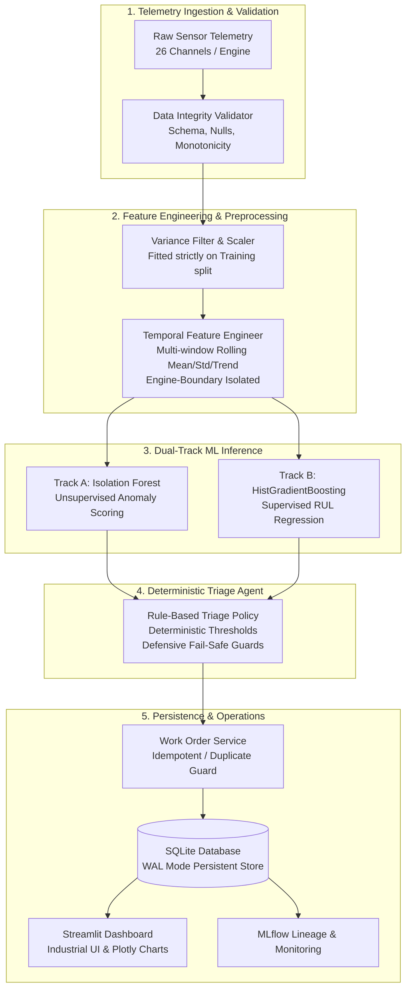
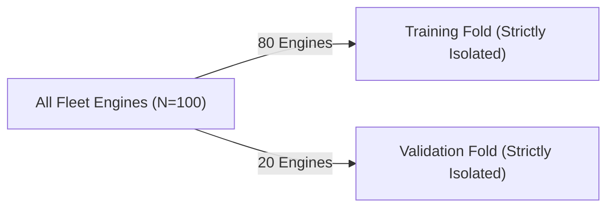
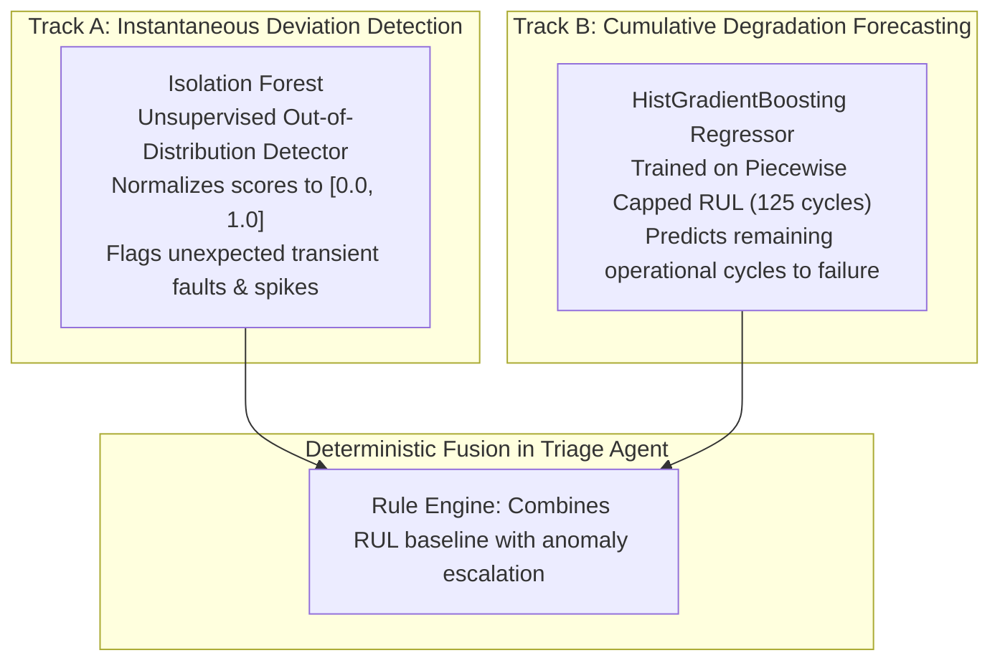
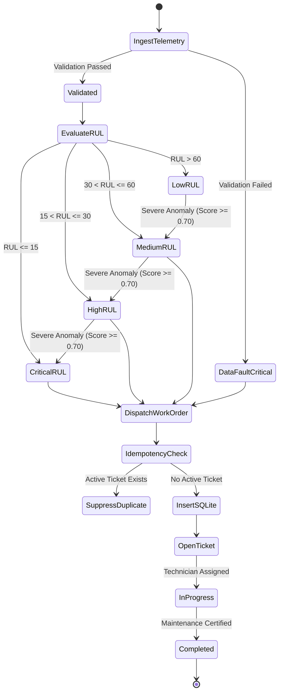

# System Architecture: Self-Healing Machines

## 1. High-Level System Architecture

The **Self-Healing Machines** platform implements an end-to-end, edge-to-depot predictive maintenance architecture for connected industrial assets. The system ingests multivariate telemetry streams, detects uncharacteristic anomalies, predicts Remaining Useful Life (RUL), applies deterministic safety triage rules, and dispatches persistent maintenance work orders to an operational SQLite registry.

---

## 2. Data Flow & Leakage Defense Mechanisms

Data leakage is the most critical failure mode in prognostic time-series models. Self-Healing Machines enforces three strict architectural safeguards:

### A. Engine-Grouped Splitting
Observations belonging to an individual physical engine are **never split** across training and validation sets. Splitting is executed using `GroupShuffleSplit` on `engine_id`.

### B. Engine Boundary Protection in Feature Windows
Rolling statistics (windows: 5, 10, 20 cycles) are calculated strictly within each engine's trajectory via `df.groupby('engine_id')`. No rolling calculation is ever allowed to cross the boundary between engine $i$ and engine $i+1$.

### C. Causal Ordering (Strict Past & Present Observations)
Features for cycle $t$ use only measurements from cycles $\tau \le t$. Future sensor readings and eventual failure cycles are never accessible during feature construction or inference.

---

## 3. Dual-Track Machine Learning Architecture

### Why Anomaly Detection and RUL Regression are Different Tasks
1. **Anomaly Detection** answers: *"Is the machine operating outside nominal statistical behavior right now?"* It is sensitive to transient events, sensor faults, and novel operating conditions.
2. **RUL Prediction** answers: *"How many operating cycles remain before structural or thermal failure?"* It learns long-term monotonic wear trajectories.
3. An anomaly is an indicator for investigation, **not a guaranteed imminent failure**. Conversely, an engine deep in its degradation trajectory might have smooth, predictable sensor trends that don't trigger anomaly detectors but have a critically low RUL.

---

## 4. Deterministic Triage & Work Order Lifecycle

Maintenance workflows in safety-critical systems must never rely on probabilistic generative AI models (LLMs) that can hallucinate. The platform implements deterministic Python decision rules:

